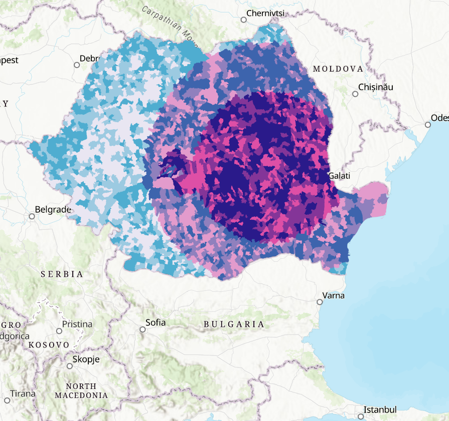
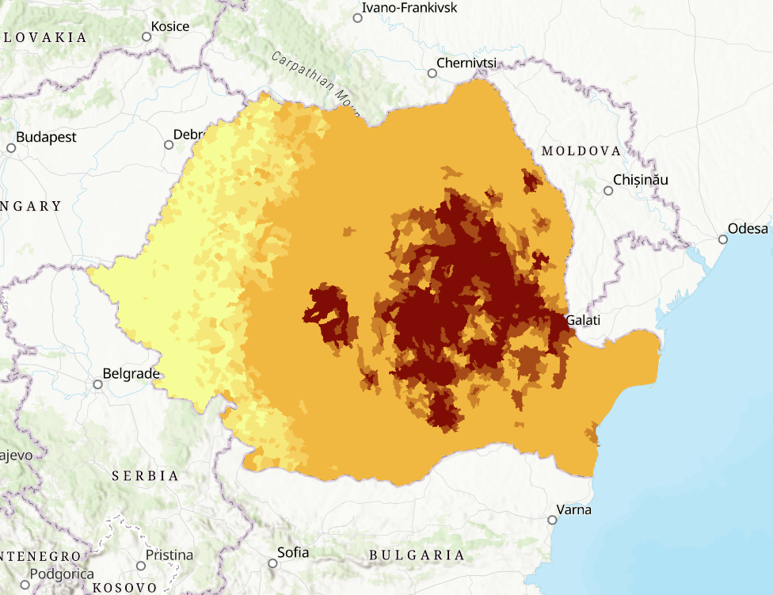
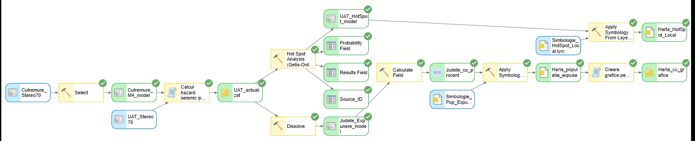
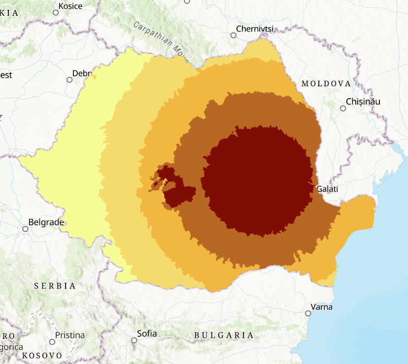
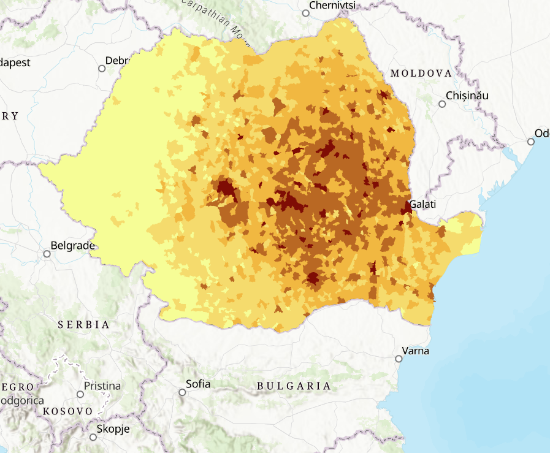
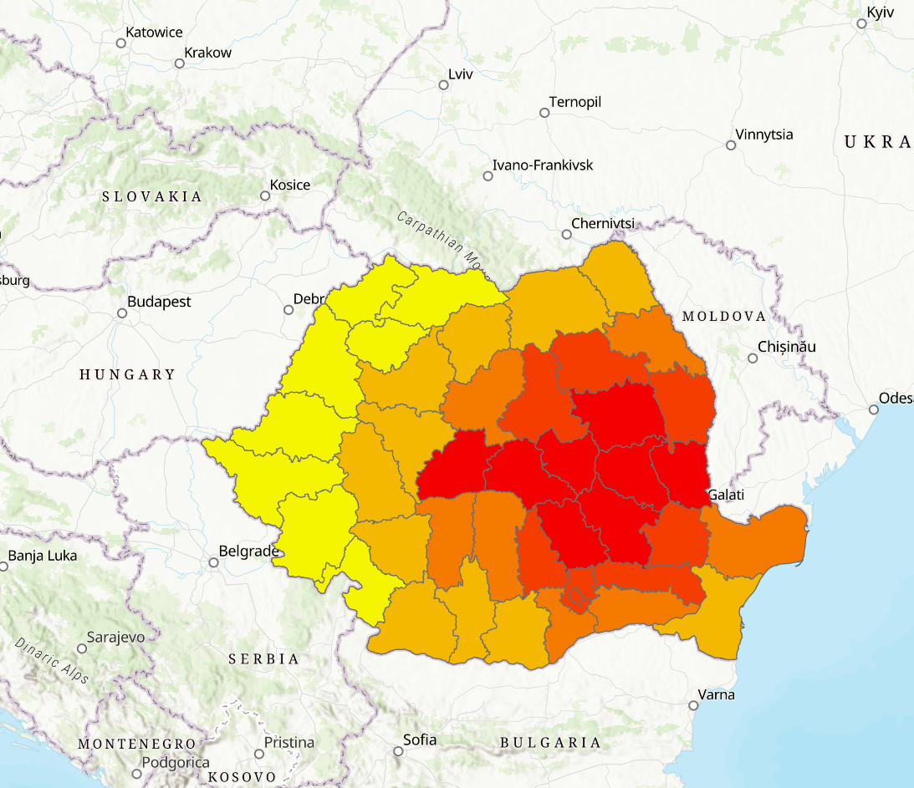
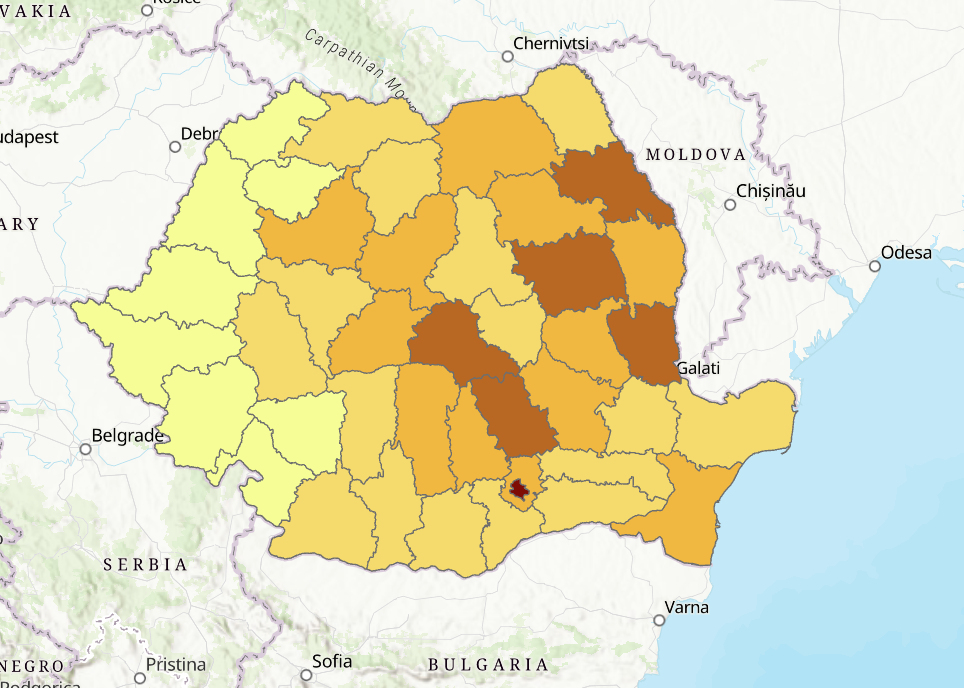
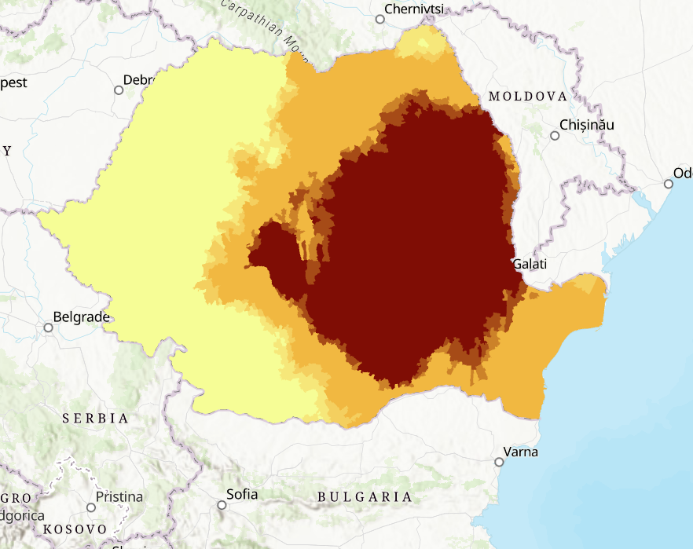
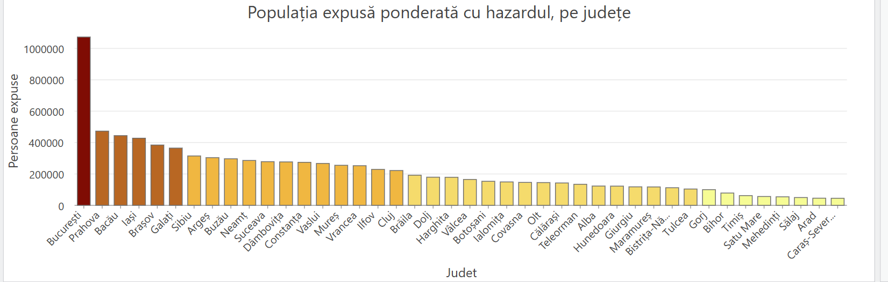
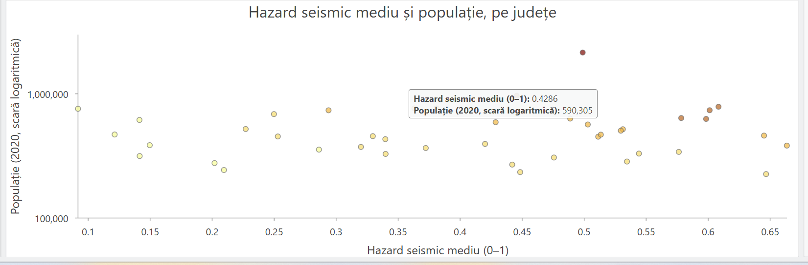

# Seismic Exposure Analysis of Romania

**Where do earthquakes hit hardest, and who lives there?** A spatial analysis of earthquake hazard and population exposure for all 3,186 municipalities (UAT) and 42 counties of Romania, built in ArcGIS Pro with custom Python geoprocessing tools and a fully automated ModelBuilder workflow.

📄 **[Read the full report with all maps and interpretations](https://RalukaAndreea.github.io/seismic-exposure-romania/)** (in Romanian)

<p align="center">
  
  
</p>

## The problem

Romania has one of the most active intermediate-depth seismic sources in Europe: the **Vrancea zone**, where earthquakes occur 60 to 200 km below the surface. Because they are deep, these earthquakes are felt over a very large area. The 1977 earthquake (Mw 7.4) killed 1,578 people, 1,391 of them in Bucharest, roughly 150 km from the epicenter.

Seismic risk is usually described as **Hazard × Exposure × Vulnerability**. This project models the first two factors at municipality level, aggregates them to counties, and tests where exposure forms statistically significant clusters.

## Key findings

- **One source dominates the country.** For 98% of municipalities (3,127 of 3,186), the strongest expected shaking comes from an intermediate-depth Vrancea earthquake. Local crustal sources dominate only small areas around Făgăraș, Banat and Crișana.
- **Maximum hazard and maximum exposure do not coincide.** Vrancea county has the highest hazard but ranks only in the middle by exposed population. Bucharest has a medium hazard but, with over 2.1 million residents, about **1.07 million hazard-weighted exposed people**, more than twice any other county.
- **Two different answers at county level.** By intensity (population-weighted hazard), the counties around Vrancea lead, for example Buzău at 64.4% versus Arad at 9.8%. By number of people, Bucharest leads, followed by Prahova, Bacău, Iași, Brașov and Galați.
- **Scale changes the answer.** At regional scale, the hot spot analysis marks the whole eastern half of the country as a risk zone. At local scale, it breaks into distinct clusters, including the **Bucharest–Ilfov metropolitan area**, which the hazard map alone does not reveal.

## Method

### 1. Data preparation
- Earthquake catalog **ROMPLUS** (INFP): 39,597 events with moment magnitude, depth and source zone, filtered to **1,085 events with Mw ≥ 4**.
- Municipality and county boundaries with **2020 population**.
- All layers reprojected from Web Mercator to **Stereo 70 (EPSG:3844)**. In Web Mercator, distances at Romania's latitude are inflated by about 40% and areas by about 2×, which would have distorted every distance-based calculation.

### 2. Seismic hazard per municipality (custom Python tool)
Instead of circular buffers, hazard is computed from the **hypocentral distance**, which accounts for earthquake depth:

```
R      = sqrt(horizontal_distance² + depth²)      [km]
score  = Mw − 1.5 · log10(R)
HAZARD = max(score) over all earthquakes, normalized to 0–1
```

For each municipality the tool keeps the strongest effect across the whole catalog (a worst-case historical scenario) and records which earthquake, year and source zone produced it.

### 3. Exposure
```
POP_N    = normalized log10(population)          (log scale, otherwise Bucharest flattens everything else)
EXPOSURE = HAZARD_N × POP_N
EXPOSED_POPULATION = population × HAZARD_N       (summed by county)
```

### 4. Spatial statistics
**Getis-Ord Gi\*** hot spot analysis on municipality exposure, at two scales:
- **regional:** Optimized Hot Spot Analysis, with the neighborhood distance chosen automatically from spatial autocorrelation;
- **local:** contiguity-based neighbors (shared edges or corners) with **False Discovery Rate** correction.

### 5. Automation
The full workflow runs as a single **ModelBuilder** model with two branches: a hot spot branch at municipality level and an aggregation branch at county level. Each branch ends in an automatically symbolized map, and the county branch also generates the charts.



Two steps are custom **Python script tools**, because ArcGIS has no built-in tool for them:
- [`hazard_seismic_final.py`](scripts/hazard_seismic_final.py): hypocentral-distance hazard, normalization, exposure and dominant source per municipality (arcpy + NumPy, vectorized over all earthquakes). It also supports scenario runs with separate output fields and an optional **directivity** parameter (elliptical attenuation along the NE–SW axis typical of Vrancea earthquakes).
- [`grafice_judete.py`](scripts/grafice_judete.py): builds the bar and scatter charts with `arcpy.charts` and attaches them to the output layer, with optional SVG export.

## Maps

| Seismic hazard | Exposure |
|---|---|
|  |  |
| **Exposed population, % (county)** | **Exposed population, people (county)** |
|  |  |
| **Hot spots, regional scale** | **Hot spots, local scale** |
|  |  |




## Limitations

- **Simplified attenuation.** The same coefficient (K = 1.5) is used for deep and shallow earthquakes, and shaking decreases equally in all directions. Real Vrancea earthquakes propagate along a NE–SW axis; the directivity option in the script is a sensitivity test, not a calibrated model.
- **No site effects or building vulnerability.** Bucharest sits on thick sediments that amplify long-period waves, and part of its building stock is old. This is why the real 1977 damage there was far greater than distance alone suggests.
- **Historical earthquakes** have estimated, not instrumentally measured, locations and magnitudes.
- **Relative values.** Hazard is normalized to the national maximum, so results compare places with each other and do not express damage probability.

## Repository structure

```
├── README.md
├── docs/index.html        full report (Romanian), published with GitHub Pages
├── scripts/               Python script tools used in the model
├── images/                maps, charts and the ModelBuilder diagram
└── .gitignore
```

## Data and reproduction

The source data is **not included** in this repository. To reproduce the analysis you need:
- the ROMPLUS earthquake catalog from the [National Institute for Earth Physics (INFP)](https://www.infp.ro/), with the fields `Mw`, `Depth`, `Year_UTC` and `Source_name`;
- municipality (UAT) boundaries with a `pop2020` population field and a `jud` county field, for example from [geo-spatial.org](https://geo-spatial.org/) or [ANCPI](https://geoportal.ancpi.ro/).

Then project both layers to EPSG:3844, add `hazard_seismic_final.py` as a script tool (parameters are documented at the top of the file), and run it on the municipality layer.

## Tools

ArcGIS Pro · ModelBuilder · Python (arcpy, NumPy, arcpy.charts) · Spatial Statistics (Getis-Ord Gi\*)

---
Course project for *Spatial Databases* (Baze de date spațiale), MSc Databases for Business Support, Bucharest University of Economic Studies (ASE).
